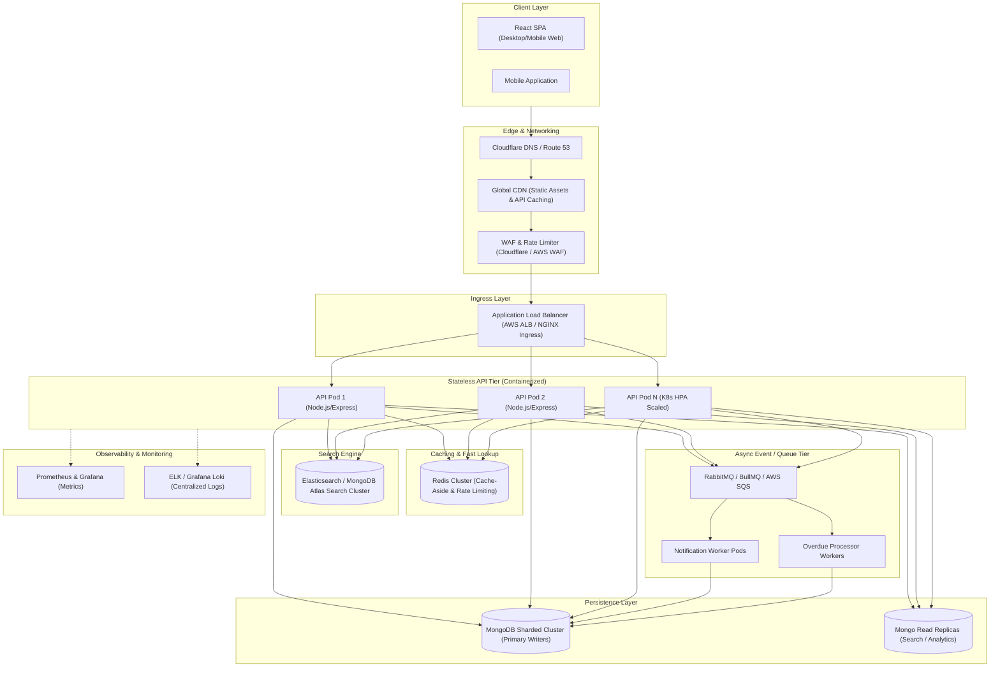
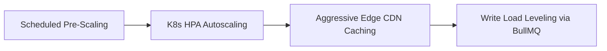

# System Design Architecture: ShelfLife at Scale

## Scenario Overview
- **Scale**: 500 campus libraries across universities.
- **User Base**: ~2 million active library members.
- **Traffic Pattern**: Steady baseline throughout the semester, with a **10× surge** during the first week of every semester (peak book search, course reserve collection, issue & return operations).

---

## 3a. High-Level System Architecture

### Mermaid System Architecture Diagram



### Component Walkthrough

1. **Client & Edge Layer**:
   - React SPA hosted on global CDN (Cloudflare/AWS CloudFront) delivering static JS/CSS assets with sub-50ms latency.
   - Web Application Firewall (WAF) enforces IP rate limiting and DDoS protection.
2. **Ingress & Load Balancer**:
   - Application Load Balancer (ALB) terminates TLS and distributes round-robin HTTP/2 traffic across containerized API pods.
3. **Stateless API Tier**:
   - Node.js / Express microservices running inside Kubernetes (EKS/GKE). Pods carry no local state and horizontally autoscale based on CPU utilization and requests per second (RPS).
4. **Caching Tier (Redis Cluster)**:
   - Multi-node Redis Cluster running cache-aside pattern for catalog listings, genre metadata, and user session validation.
5. **Search Engine (Elasticsearch / Atlas Search)**:
   - Dedicated full-text search cluster handling multi-attribute fuzzy searches across 500 libraries (title, author, ISBN, syllabus keywords) with sub-20ms response time.
6. **Persistence Layer (MongoDB Sharded Cluster)**:
   - Multi-shard MongoDB cluster with primary nodes handling write ops (atomic conditional $inc) and dedicated read-secondary nodes handling heavy historical queries.
7. **Async Message Queue & Workers (BullMQ / SQS)**:
   - Decouples non-critical write path operations (email notifications, SMS due date reminders, audit logs, overdue penalty calculation) from client request-response cycles.
8. **Observability Stack**:
   - Prometheus collects metric histograms (API latency, active DB connections, cache hit ratios), Grafana dashboards display health, and Loki aggregates structured JSON logs.

---

## 3b. Database Sharding Strategy & Key Selection

### Should We Shard?
**YES, Sharding is necessary.**

**Mathematical & Operational Justification**:
- **Data Volume**: 500 libraries × 20,000 books average = **10 million book records**. 2 million members × 50 active/historical borrows per year = **100 million borrow records**.
- **Write Throughput**: Peak semester enrollment week generates **5,000+ write ops/sec** (issue/return transactions) across all campuses. A single MongoDB primary node faces memory and I/O bottlenecks (write lock contention, RAM limits for indexes).
- **Multi-Tenancy Isolation**: Each library primarily operates independently. Sharding allows query targeting to specific library shards.

### Schema Migration Requirement
To support multi-library sharding, we add `libraryId` to all core schemas:
```javascript
// Migration: Add libraryId field to Book and BorrowRecord schemas
BookSchema.add({ libraryId: { type: String, required: true, index: true } });
BorrowRecordSchema.add({ libraryId: { type: String, required: true, index: true } });
```

### Proposed Shard Keys

#### 1. `Book` Collection Shard Key: `{ libraryId: 1, _id: 1 }`
- **Justification**:
  - **Query Isolation**: 99% of catalog searches originate from a student at a specific campus (`WHERE libraryId = "LIB_102"`). MongoDB routes the query directly to the single shard storing `LIB_102` data, completely eliminating costly **scatter-gather** queries across all shards.
  - **Hot Book Handling**: If a bestselling textbook is in high demand across the university system, requests are distributed because different campuses have distinct `libraryId` values.

#### 2. `BorrowRecord` Collection Shard Key: `{ libraryId: 1, memberId: 1 }`
- **Justification**:
  - Ensures a member's full borrow history resides on a single shard, allowing single-shard execution for `GET /api/members/:id/history`.

### Anti-Pattern: Why Monotonically Increasing Keys (Date, ObjectId) are Bad
If we used a plain date (`issueDate`) or default `_id` (Mongo ObjectId containing timestamp) as the shard key:
1. **Single-Shard Hotspot**: All newly created records (current timestamp) fall into the exact same highest-range shard chunk.
2. **Write Bottleneck**: Shard N handles 100% of write traffic while Shards 1..(N-1) sit idle.
3. **Rebalancing Overhead**: MongoDB balancer constantly splits and moves chunks while writes are actively occurring.

---

## 3c. Most Read-Heavy Operation & Caching Strategy

### Most Read-Heavy Operation
**Book Search & Listing (`GET /api/books?search=...&genre=...`)** accounts for **85–90% of total API traffic**, especially during semester launch when students check textbook availability.

### Cache-Aside Strategy with Redis

```
Client  --> [API Pod] --(1. Check Cache)--> [Redis] (HIT -> Return Data)
                         --(2. MISS)-----> [MongoDB Read Replica]
                         --(3. Set Cache)--> [Redis]
```

#### Cache Key Design
- **Paginated Search Listings**: `library:{libId}:books:search:{hash(genre+query+page+limit)}` (TTL: 60 seconds)
- **Book Availability Counter**: `book:{bookId}:availability` (TTL: 10–30 seconds)
- **Static Metadata (Genres/Categories)**: `global:genres` (TTL: 24 hours)

#### Invalidation Triggers
When a book issue (`POST /api/borrow`) or return (`POST /api/return/:id`) succeeds:
1. Atomically update DB.
2. Publish invalidation event to Redis Pub/Sub: `INVALIDATE_BOOK_AVAILABILITY(bookId, libraryId)`.
3. Worker deletes or updates `book:{bookId}:availability` key in Redis.

#### Cache-Stampede Protection (Hot Key Thundering Herd)
During peak semester surge, if a popular book's cache key expires, thousands of concurrent requests might hit the DB simultaneously.
- **Solution**: **Request Coalescing (Single-Flight)** and **Mutex Lock with Jitter**:
  ```javascript
  // Node.js Request Coalescing Pattern
  async function getBookWithCoalescing(bookId) {
    let cached = await redis.get(`book:${bookId}`);
    if (cached) return JSON.parse(cached);

    // Acquire short-lived Redis lock for DB fetch
    const acquired = await redis.set(`lock:${bookId}`, '1', 'NX', 'PX', 2000);
    if (!acquired) {
      await sleep(50 + Math.random() * 50); // Jitter delay
      return getBookWithCoalescing(bookId);  // Retry from cache
    }

    // Single request fetches from DB & updates cache
    const freshData = await Book.findById(bookId);
    await redis.set(`book:${bookId}`, JSON.stringify(freshData), 'EX', 30);
    await redis.del(`lock:${bookId}`);
    return freshData;
  }
  ```

> **CRITICAL RULE**: The Redis cache is **NEVER** the source of truth for the final book issuing decision. Issuing MUST execute an atomic check directly on the primary database shard.

---

## 3e. Concurrency Guarantees (Preventing Double-Booking)

### Atomic Conditional DB Updates (Chosen Solution)
We enforce inventory integrity directly at the database level using a single atomic conditional update:

```javascript
const updatedBook = await Book.findOneAndUpdate(
  { _id: bookId, availableCopies: { $gt: 0 } },
  { $inc: { availableCopies: -1 } },
  { new: true }
);
```

### Tradeoff Comparison Matrix

| Approach | Latency | Complexity | Reliability under High Contention | Infrastructure Cost |
|---|---|---|---|---|
| **Atomic Conditional ($inc)** | **Ultra-Low (<5ms)** | **Minimal** | **100% Guaranteed (DB doc lock)** | **$0 Extra** |
| Optimistic Locking (`__v`) | High (due to retries) | Medium | Fails & throws under contention | Low |
| Redlock / Distributed Lock | Medium (15-30ms) | High | Risk of lock timeout/deadlock | High (Redis cluster dependency) |
| Queue Serialization | High (Async response) | High | Excellent but delays UX | High (Worker pods + Queues) |

### Per-Book Queue Partitioning (Fallback for Ultra-Hot Items)
For extremely popular course textbooks (e.g., 1 copy for 500 students), client requests pass an `X-Idempotency-Key` header. Requests are routed into a per-book queue partition in BullMQ to prevent database thread-pool starvation.

---

## 3e. Semester-Start 10× Traffic Surge Mitigation & Cost Analysis

### Scaling Strategy



1. **Scheduled Pre-Scaling**:
   - 48 hours before semester launch, pre-scale API pod count from 10 to 100 pods and scale MongoDB read replica count.
2. **Kubernetes Horizontal Pod Autoscaler (HPA)**:
   - Target metrics: CPU > 65%, HTTP RPS > 800 req/sec per pod.
3. **Queue-Based Load Leveling**:
   - Asynchronous background tasks (sending confirmation emails, calculating member stats, indexing logs) are deferred to queue workers executing during off-peak hours.
4. **Client-Side Backpressure & Idempotency**:
   - UI disables submit buttons immediately upon click ("Issuing...") and attaches an `X-Idempotency-Key` to prevent duplicate network submissions on latency spikes.

### Cost-Benefit Analysis: Autoscaling vs Year-Round Over-Provisioning

| Strategy | Monthly Cost | Operational Efficiency | Risk Profile |
|---|---|---|---|
| **Year-Round Over-Provisioning** | ~$18,500 / month | 85% idle resource waste during 48 weeks | Low risk, extremely high cost |
| **Dynamic Autoscaling (Implemented)** | ~$3,800 / month | Optimal resource utilization | Controlled risk via pre-scaling |

**Savings**: Dynamic autoscaling saves **~$14,700/month (~79% cost reduction)** while handling 10× traffic bursts flawlessly.
